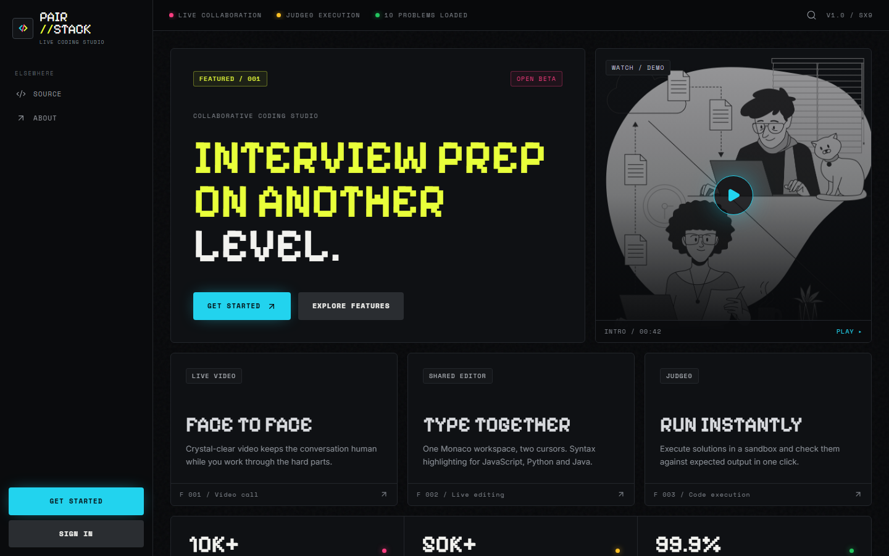

<div align="center">


# PAIRSTACK

**LIVE CODING STUDIO // PAIR PROGRAMMING // INTERVIEW PRACTICE**

[](https://talent-aq.onrender.com)


</div>

---

## 01 / WHAT IT IS

PAIRSTACK is a collaborative coding studio built for technical interviews and pair programming. Create a room, let the host choose the challenge, meet face-to-face, and run solutions against a real judge — without leaving the workspace.



---

## 02 / FEATURES

- `01` **Live rooms** — create a room first; the host picks the problem once inside
- `02` **Host-only control** — only the host can choose or change the session problem
- `03` **Video + chat** — Stream-powered calls with a built-in session chat
- `04` **Shared workspace** — Monaco editor with JavaScript, Python and Java support
- `05` **Instant execution** — Judge0 sandbox with expected-output checking
- `06` **Problem library** — 10 curated challenges across three difficulty levels
- `07` **Dashboard** — live rooms, archives and session stats at a glance
- `08` **Auth** — Clerk sign-in with protected routes and user sync via Inngest

---

## 03 / STACK

| Layer | Tools |
| --- | --- |
| **Language** | JavaScript (ESM), JSX, CSS, SVG |
| **Frontend** | React 19, Vite 7, React Router 7, Tailwind CSS 4, DaisyUI 5 |
| **State & data** | TanStack Query 5, Axios |
| **Editor** | Monaco Editor, react-resizable-panels |
| **Auth** | Clerk (React + Express) |
| **Realtime** | Stream Video SDK, Stream Chat |
| **Backend** | Node.js, Express 5, Mongoose 8 |
| **Database** | MongoDB Atlas |
| **Events** | Inngest |
| **Execution** | Judge0 CE |
| **Tooling** | ESLint, Nodemon, npm, Git |

---

## 04 / GETTING STARTED

**Requirements:** Node.js 20.19+ (or 22+), npm, and accounts for MongoDB Atlas, Clerk, Stream and Inngest.

```bash
git clone https://github.com/shahateqx/talent-aq.git
cd talent-aq
npm install --prefix backend
npm install --prefix frontend
```

Create `backend/.env`:

```env
PORT=5000
NODE_ENV=development
CLIENT_URL=http://localhost:5173
DB_URL=mongodb+srv://<user>:<password>@<cluster>/<database>
CLERK_PUBLISHABLE_KEY=pk_test_...
CLERK_SECRET_KEY=sk_test_...
STREAM_API_KEY=...
STREAM_SECRET_KEY=...
INNGEST_EVENT_KEY=...
INNGEST_SIGNING_KEY=...
```

Create `frontend/.env`:

```env
VITE_API_URL=http://localhost:5000
VITE_CLERK_PUBLISHABLE_KEY=pk_test_...
VITE_STREAM_API_KEY=...
```

Run both dev servers:

```bash
npm run dev --prefix backend    # http://localhost:5000
npm run dev --prefix frontend   # http://localhost:5173
```

Production build: `npm run build` → frontend output in `frontend/dist`, served by Express.

> Add your deployed domain to Clerk's allowed origins, and set `CLIENT_URL` to that domain.

---

## 05 / ROUTES

| Method | Endpoint | Purpose |
| --- | --- | --- |
| `GET` | `/health` | API health check |
| `POST` | `/api/sessions` | Create a room |
| `GET` | `/api/sessions/active` | List live rooms |
| `GET` | `/api/sessions/my-recent` | Your archived rooms |
| `GET` | `/api/sessions/:id` | Room details |
| `POST` | `/api/sessions/:id/join` | Join a room |
| `POST` | `/api/sessions/:id/end` | End a room (host only) |
| `POST` | `/api/sessions/:id/problem` | Set/change problem (host only) |
| `POST` | `/api/inngest` | Inngest function endpoint |

---

## 06 / ROADMAP

- [ ] Session timer with auto-end
- [ ] Auto-save code to the database
- [ ] Interviewer scorecard and notes
- [ ] Multiple problems per session
- [ ] Custom stdin test cases
- [ ] Search and difficulty filters
- [ ] Solved-problem progress tracking

---

## 07 / LIVE

**https://talent-aq.onrender.com**

Crafted by [@shahateqx](https://github.com/shahateqx) — an sX9 project.
